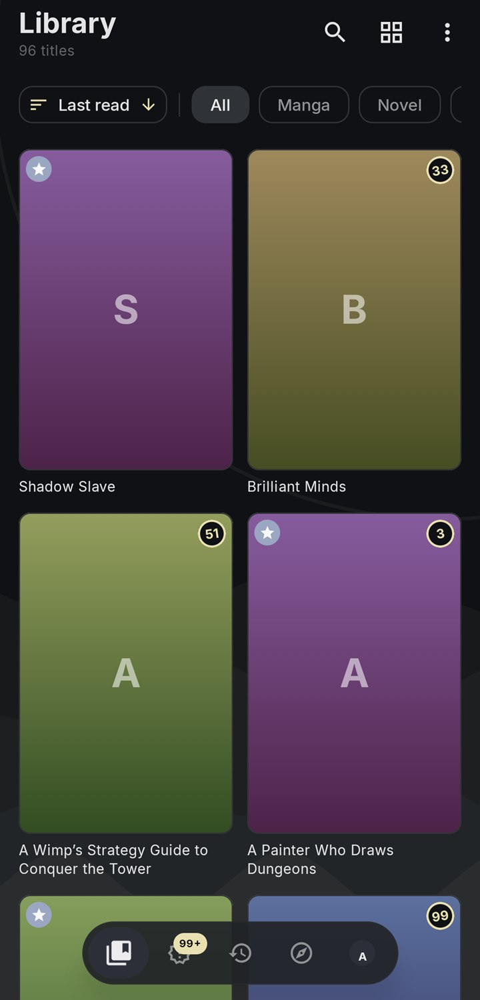
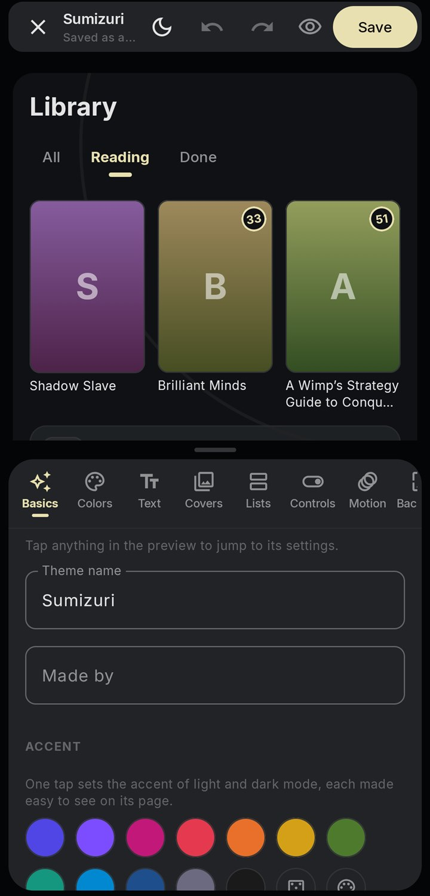

> [!IMPORTANT]
> Este es el fork de **Matsuki Ender** con los parches **Suki**: traducción al español, arreglos para Linux y para las imágenes de algunas fuentes. La app original es de Akari: [not-akari/sumizuri](https://github.com/not-akari/sumizuri). Los enlaces de descarga de abajo llevan a las versiones oficiales de Akari. Las versiones Suki (Windows, Linux con AppImage y Android) están en los [releases de este fork](https://github.com/matsukiender-star/sumizuri/releases).
>
> **Traducción al español:** [](https://weblate.notakari.com/projects/app/-/es/) (se actualiza solo; se traduce en el Weblate de Akari).

<p align="center">
  <picture>
    <source media="(prefers-color-scheme: dark)" srcset=".github/readme/banner-dark.svg">
    <source media="(prefers-color-scheme: light)" srcset=".github/readme/banner-light.svg">
    
  </picture>
</p>

<p align="center">
  <a href="https://sumizuri.notakari.com"><b>Sitio web</b></a> &nbsp;·&nbsp;
  <a href="https://github.com/not-akari/sumizuri/releases/latest"><b>Descargar</b></a> &nbsp;·&nbsp;
  <a href="docs/extensions.md"><b>Guías</b></a> &nbsp;·&nbsp;
  <a href="https://discord.gg/JZaqv5VFj7"><b>Discord</b></a>
</p>

---

Sumizuri es una sola app para lo que lees y ves. Abre archivos de tu dispositivo o conéctala a las fuentes que tú elijas. Guarda tu biblioteca, tu progreso y tus ajustes, y puede sincronizarlos entre dispositivos con un servidor que tú mismo montes.

> [!NOTE]
> Sumizuri no trae contenido ni viene con fuentes. Tú eliges qué agregar y eres responsable de ello.

<p align="center">
  
  
  
  
</p>

## Funciones

- **Manga y cómics:** páginas de derecha a izquierda, de izquierda a derecha o hacia abajo, o en scroll largo, con zonas de toque y teclas que puedes cambiar.
- **Novelas:** el texto acomodado como mejor lees, con búsqueda de palabras.
- **Anime:** un reproductor con subtítulos y pistas de audio.
- **Tus propios archivos:** carpetas de imágenes, ZIP y CBZ, y EPUB.
- **Biblioteca:** estantes, un feed de capítulos nuevos, descargas y respaldos que puedes proteger con contraseña.
- **Sincronización:** mantén tus dispositivos iguales con tu propio [servidor de sincronización](docs/sync-server.md).

## Descarga

Android 7.0 o más nuevo, iPhone y iPad (iOS 16 o más nuevo, instalado con una herramienta de sideloading), Windows, Mac (Apple silicon) y Linux. Baja la versión más nueva desde la [página de descarga](https://sumizuri.notakari.com/download) o desde los [releases](https://github.com/not-akari/sumizuri/releases/latest). Si no sabes qué archivo de Android tomar, toma el **Universal**.

## Instalación

Baja el archivo para tu dispositivo desde la página de descarga de arriba y sigue los pasos que le tocan. Sumizuri no se vende en las tiendas de apps, y los archivos de Mac y de iPhone no están firmados con una cuenta de desarrollador de Apple; por eso esos dos necesitan unos pasos de más.

### Android

1. Baja el `.apk` **Universal**, o el de tu procesador.
2. Ábrelo. Android te va a pedir permiso para instalar desde tu navegador o tu administrador de archivos. Dale permiso esta vez.
3. Presiona **Instalar**.

### iPhone y iPad

El `.ipa` no se instala con solo tocarlo. Una herramienta de sideloading lo firma con tu propio Apple ID y lo pasa al teléfono. Tu Apple ID solo va a Apple y se queda en tu computadora; nadie más lo recibe. Necesitas iOS 16 o más nuevo y una computadora, Windows o Mac, con el cable del teléfono.

Con un Apple ID gratis, la app dura **7 días**, y la herramienta la renueva mientras el teléfono esté en el mismo Wi-Fi que la computadora. Un Apple ID gratis también deja tener unas 3 apps a la vez.

#### Con Sideloadly

1. Instala [Sideloadly](https://sideloadly.io) en tu computadora.
2. En el teléfono, activa **Configuración**, luego **Privacidad y seguridad**, luego **Modo de desarrollador**. El teléfono se reinicia.
3. Conecta el teléfono con el cable y abre Sideloadly.
4. Arrastra el `.ipa` a Sideloadly, escribe tu Apple ID y presiona **Start**.
5. En el teléfono, abre **Configuración**, luego **General**, luego **VPN y gestión de dispositivos**, toca tu Apple ID en App de desarrollador y luego **Confiar**.
6. Abre Sumizuri.

#### Con AltStore

1. Instala [AltServer](https://altstore.io) en tu computadora y úsalo para instalar AltStore en el teléfono, con el Modo de desarrollador activado como arriba.
2. Confía en tu Apple ID en **Configuración**, luego **General**, luego **VPN y gestión de dispositivos**.
3. Baja el `.ipa` en el teléfono y guárdalo en la app Archivos.
4. En AltStore, abre **My Apps**, presiona **+** y elige el `.ipa`.
5. Deja AltServer abierto en tu computadora para que AltStore pueda renovar la app cada semana.

#### Con Xcode, si tienes Mac

1. Instala [XcodeGen](https://github.com/yonaskolb/XcodeGen) y corre `xcodegen` en la carpeta `iosApp` del código.
2. Abre `Sumizuri.xcodeproj`. En **Signing & Capabilities**, elige tu Apple ID como equipo y cambia el bundle identifier por uno tuyo, como `com.yourname.sumizuri`.
3. Conecta el teléfono, activa el Modo de desarrollador, elige el teléfono arriba y presiona Run.

### Windows

1. Baja el `-setup.exe` y ábrelo.
2. Si Windows muestra **Windows protegió su PC**, presiona **Más información** y luego **Ejecutar de todas formas**. El instalador no está firmado.
3. Sigue el instalador. Se instala solo para tu usuario, así que no necesita permisos de administrador.

### Mac

La imagen de disco es para Mac con Apple silicon, como la M1 y más nuevas. Las Mac con procesador Intel no son compatibles.

1. Abre el `.dmg` y arrastra **Sumizuri** a **Aplicaciones**.
2. La primera vez, la Mac dice que no puede verificar la app porque no está firmada. Abre **Configuración del Sistema**, luego **Privacidad y seguridad**, baja y presiona **Abrir de todos modos** junto a Sumizuri. O corre esto una vez en la Terminal:

   ```bash
   xattr -cr /Applications/Sumizuri.app
   ```

3. Para video, instala [mpv](https://mpv.io) con `brew install mpv`. Las imágenes y las novelas no necesitan nada más.

### Linux

- En Debian y Ubuntu, instala el `.deb` con `sudo apt install ./Sumizuri-*-linux-amd64.deb`.
- En otras distros, descomprime el `.tar.gz` y corre `Sumizuri/bin/Sumizuri`.
- Para video, instala mpv; por ejemplo, el paquete `libmpv2`.

### Actualizar

Abre **Ajustes** y luego **Actualizaciones de la app**. Sumizuri busca una versión nueva; tú presionas **Descargar** y luego **Instalar**.

| Dispositivo | Qué hace Instalar |
| --- | --- |
| Android | Le pasa el `.apk` nuevo al instalador del teléfono. |
| Windows | Abre el instalador nuevo, que primero cierra la app. |
| Mac | Abre la imagen de disco nueva. Cierra Sumizuri, arrastra el **Sumizuri** nuevo a **Aplicaciones** y presiona **Reemplazar**. |
| Linux | Abre el paquete nuevo, donde el sistema lo permite. |
| iPhone y iPad | La app no puede actualizarse sola. Te avisa que salió una versión nueva y abre la página del release. Baja el `.ipa` nuevo e instálalo igual que antes. Tu biblioteca se queda. |

## Guías

- [Escribir extensiones](docs/extensions.md): conecta Sumizuri a una API.
- [Scripts de bloques de perfil](docs/profile-blocks.md): haz tus propios bloques de perfil.
- [Montar un servidor de sincronización](docs/sync-server.md): monta el tuyo, con Docker.

## Compilar

Necesitas JDK 21, y el SDK de Android para la app de Android.

```bash
./gradlew :app:desktop:runReleaseDistributable   # run the desktop app
./gradlew :app:android:assembleDebug             # build an Android debug APK
./gradlew :sync:server:installDist               # build the sync server
./gradlew :app:desktop:packageReleaseDmg         # build the Mac disk image, on a Mac
```

La app de iPhone y iPad necesita una Mac con Xcode y [XcodeGen](https://github.com/yonaskolb/XcodeGen). Corre `xcodegen` en `iosApp`, abre `Sumizuri.xcodeproj`, elige un dispositivo y córrela. Xcode compila la parte de Kotlin con Gradle. Con un Apple ID gratis, elígelo en Signing & Capabilities para instalarla en tu propio teléfono.

Antes de mandar un pull request, lee la [guía para contribuir](CONTRIBUTING.md) y corre `bash scripts/check-repo.sh`. Para reportar un problema de seguridad, revisa la [política de seguridad](SECURITY.md).

## Contenido

Sumizuri es una app, no un servicio de contenido. No aloja, vende ni reparte contenido, y no tiene servidores que guarden contenido. Las fuentes y los repos los hacen otras personas, y este proyecto no los revisa ni responde por ellos. Revisa los [términos](docs/terms.md) y la [página de privacidad](docs/privacy.md).

## Licencia

Sumizuri es software libre bajo la [GNU General Public License v3.0](LICENSE). Puedes usarlo, modificarlo y compartirlo, y todo lo que construyas encima y compartas tiene que quedarse bajo la misma licencia.
