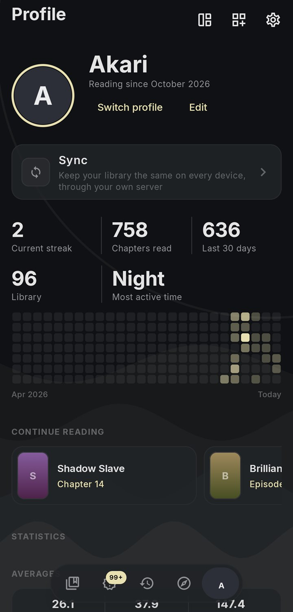
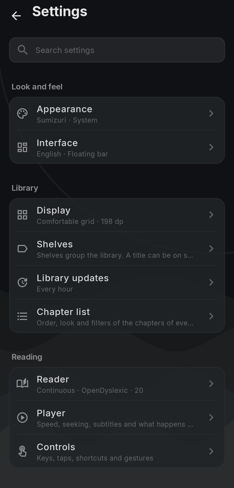

<p align="center">
  <picture>
    <source media="(prefers-color-scheme: dark)" srcset=".github/readme/banner-dark.svg">
    <source media="(prefers-color-scheme: light)" srcset=".github/readme/banner-light.svg">
    
  </picture>
</p>

<p align="center">
  <a href="https://sumizuri.notakari.com"><b>Website</b></a> &nbsp;·&nbsp;
  <a href="https://github.com/not-akari/sumizuri/releases/latest"><b>Download</b></a> &nbsp;·&nbsp;
  <a href="docs/extensions.md"><b>Guides</b></a> &nbsp;·&nbsp;
  <a href="https://discord.gg/JZaqv5VFj7"><b>Discord</b></a>
</p>

---

Sumizuri is one app for the things you read and watch. Open files from your device, or connect it to sources you choose. It keeps your library, progress and settings, and can sync them between devices through a server you host yourself.

> [!NOTE]
> Sumizuri comes with no content and lists no sources by default. You choose what to add, and you are responsible for it.

<p align="center">
  
  &nbsp;
  
</p>

## Features

- **Manga and comics:** pages right to left, left to right or downwards, or a long scroll, with tap zones and keys you can change.
- **Novels:** text set the way you read best, with word lookup.
- **Anime:** a player with subtitles and audio tracks.
- **Your own files:** folders of pictures, ZIP and CBZ, and EPUB.
- **Library:** shelves, a feed of new chapters, downloads, and backups you can lock with a password.
- **Sync:** keep devices the same through your own [sync server](docs/sync-server.md).

## Download

Android 7.0 and newer, iPhone and iPad (iOS 16 and newer, installed with a sideloading tool), Windows, Mac (Apple silicon) and Linux. Get the newest version from the [download page](https://sumizuri.notakari.com/download) or the [releases](https://github.com/not-akari/sumizuri/releases/latest). If you are not sure which Android file to take, take **Universal**.

## Install

Get the file for your device from the download page above, then follow the steps for it below. Sumizuri is not sold through the app stores, and the Mac and iPhone files are not signed with an Apple developer account, which is why those two need a few extra steps.

### Android

1. Download the **Universal** `.apk`, or the one for your processor.
2. Open it. Android asks you to allow installs from your browser or file manager. Allow it for this once.
3. Press **Install**.

### iPhone and iPad

The `.ipa` cannot be installed by tapping it. A sideloading tool signs it with your own Apple ID and puts it on the phone. Your Apple ID goes to Apple and stays on your computer. Nobody else gets it. You need iOS 16 or newer and a computer, Windows or Mac, with the phone's cable.

A free Apple ID makes an app that lasts **7 days**, and the tool renews it while the phone is on the same Wi-Fi as the computer. A free Apple ID also allows about 3 apps at a time.

#### With Sideloadly

1. Install [Sideloadly](https://sideloadly.io) on your computer.
2. On the phone, turn on **Settings**, then **Privacy & Security**, then **Developer Mode**. The phone restarts.
3. Connect the phone with the cable and open Sideloadly.
4. Drag the `.ipa` into Sideloadly, type your Apple ID and press **Start**.
5. On the phone, open **Settings**, then **General**, then **VPN & Device Management**, press your Apple ID under Developer App and **Trust**.
6. Open Sumizuri.

#### With AltStore

1. Install [AltServer](https://altstore.io) on your computer and use it to install AltStore on the phone, with Developer Mode on as above.
2. Trust your Apple ID under **Settings**, then **General**, then **VPN & Device Management**.
3. Download the `.ipa` on the phone and keep it in the Files app.
4. In AltStore, open **My Apps**, press **+** and pick the `.ipa`.
5. Leave AltServer running on your computer, so AltStore can renew the app every week.

#### With Xcode, if you have a Mac

1. Install [XcodeGen](https://github.com/yonaskolb/XcodeGen) and run `xcodegen` in the `iosApp` folder of the code.
2. Open `Sumizuri.xcodeproj`. Under **Signing & Capabilities**, pick your Apple ID as the team, and change the bundle identifier to one of your own, such as `com.yourname.sumizuri`.
3. Connect the phone, turn on Developer Mode, pick the phone at the top and press Run.

### Windows

1. Download the `-setup.exe` and run it.
2. If Windows shows **Windows protected your PC**, press **More info**, then **Run anyway**. The installer is not signed.
3. Follow the setup. It installs for you only, so it needs no administrator.

### Mac

The disk image is for Macs with Apple silicon, such as the M1 and newer. Macs with an Intel processor are not supported.

1. Open the `.dmg` and drag **Sumizuri** onto **Applications**.
2. The first time, a Mac says it cannot check the app, because it is not signed. Open **System Settings**, then **Privacy & Security**, scroll down and press **Open Anyway** next to Sumizuri. Or run this once in the Terminal:

   ```bash
   xattr -cr /Applications/Sumizuri.app
   ```

3. For video, install [mpv](https://mpv.io) with `brew install mpv`. Pictures and novels need nothing more.

### Linux

- On Debian and Ubuntu, install the `.deb` with `sudo apt install ./Sumizuri-*-linux-amd64.deb`.
- On other Linux, unpack the `.tar.gz` and run `Sumizuri/bin/Sumizuri`.
- For video, install mpv, for example the `libmpv2` package.

### Update

Open **Settings**, then **App updates**. Sumizuri looks for a new version, and you press **Download**, then **Install**.

| Device | What Install does |
| --- | --- |
| Android | Hands the new `.apk` to the installer of the phone. |
| Windows | Runs the new installer, which closes the app first. |
| Mac | Opens the new disk image. Quit Sumizuri, then drag the new **Sumizuri** onto **Applications** and press **Replace**. |
| Linux | Opens the new package, where the system can. |
| iPhone and iPad | The app cannot update itself. It tells you a new version is out and opens the release page. Download the new `.ipa` and install it the same way as before. Your library stays. |

## Guides

- [Writing extensions](docs/extensions.md): connect Sumizuri to an API.
- [Profile block scripts](docs/profile-blocks.md): make your own profile blocks.
- [Run a sync server](docs/sync-server.md): host your own, with Docker.

## Build

You need JDK 21, and the Android SDK for the Android app.

```bash
./gradlew :app:desktop:runReleaseDistributable   # run the desktop app
./gradlew :app:android:assembleDebug             # build an Android debug APK
./gradlew :sync:server:installDist               # build the sync server
./gradlew :app:desktop:packageReleaseDmg         # build the Mac disk image, on a Mac
```

The iPhone and iPad app needs a Mac with Xcode and [XcodeGen](https://github.com/yonaskolb/XcodeGen). Run `xcodegen` in `iosApp`, open `Sumizuri.xcodeproj`, pick a device and run. Xcode builds the Kotlin side through Gradle. With a free Apple ID, choose it under Signing & Capabilities to install on your own phone.

Before a pull request, read the [contributing guide](CONTRIBUTING.md) and run `bash scripts/check-repo.sh`. To report a security problem, see the [security policy](SECURITY.md).

## Content

Sumizuri is an app, not a content service. It does not host, sell or hand out any content, and it runs no servers that hold content. Sources and repos are made by other people and are not checked or stood behind by this project. See the [terms](docs/terms.md) and the [privacy page](docs/privacy.md).

## License

Sumizuri is free software under the [GNU General Public License v3.0](LICENSE). You may use, change and share it, and anything you build on it and share must stay under the same license.
